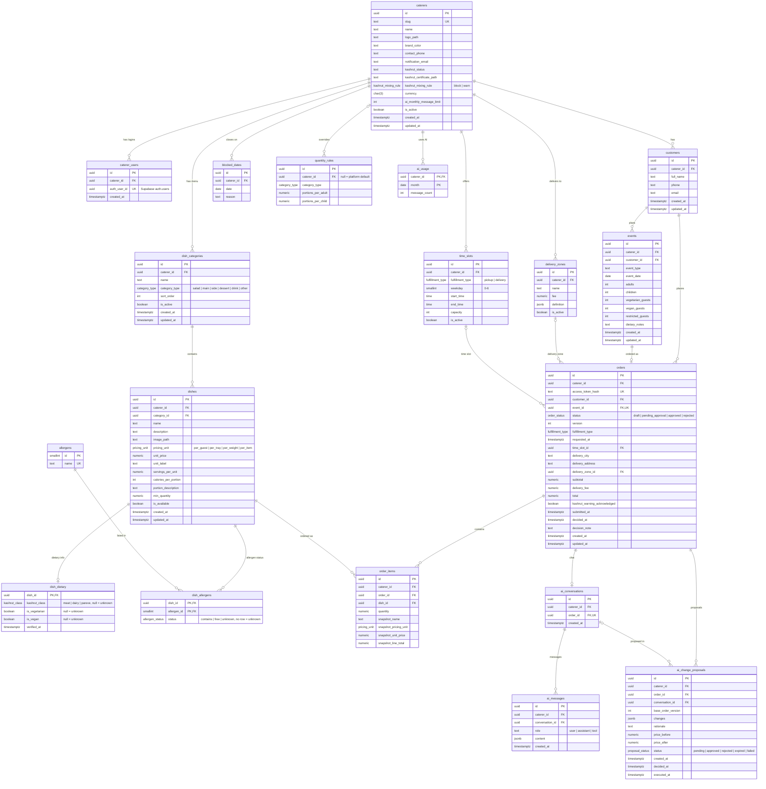

# Entity relationship diagram

The Postgres schema from `supabase/migrations/20261105000000_schema.sql`.
Column details and rules are in `DATABASE_SCHEMA.md`; row-level security, Storage and
Realtime are in `supabase/migrations/20261105000100_rls_storage_realtime.sql`.

Notes:

- Every table except `allergens` and `dish_dietary`/`dish_allergens` (which hang off
  `dishes`) has a `caterer_id`. To keep the diagram readable, only the top-level
  tables draw a line to `caterers`; the rest reach it through their parent, and
  composite foreign keys on `(caterer_id, ...)` keep the whole chain in one caterer.
- Ids are `uuid` (from `gen_random_uuid()`), except `allergens.id`, a `smallint` identity.
- Money columns are `numeric(10, 2)` in the caterer's currency (ILS by default). Quantities are
  `numeric(10, 2)` and portion rules `numeric(5, 2)`. Mermaid can't show the precision,
  so the diagram says `numeric`.
- Times are `timestamptz`; `date` and `time` columns hold a calendar day or a time of day.
- Columns typed with an enum name use Postgres enums; the comment lists the values.
- `caterer_users.auth_user_id` references Supabase's `auth.users`, which is outside this diagram.
- `quantity_rules.caterer_id` is nullable: null is the platform default.

